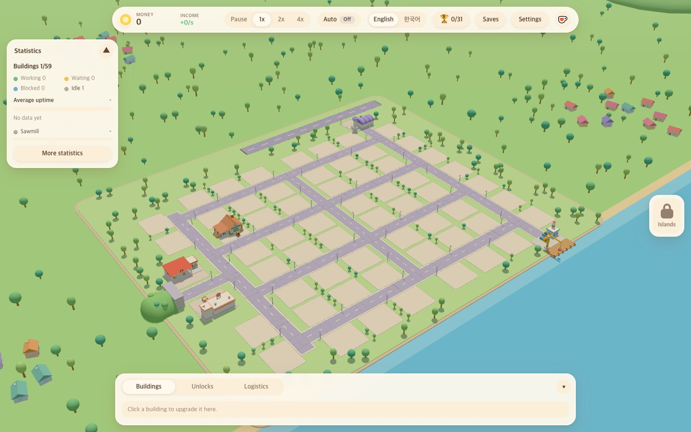
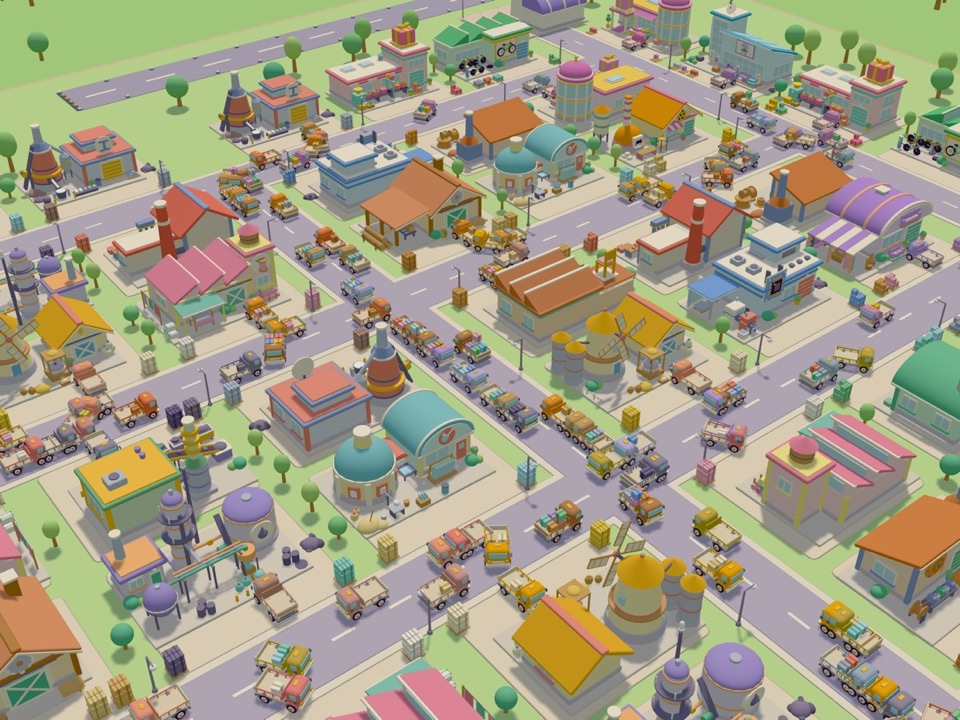

# Warehouse Tycoon

**English** | [한국어](README.ko.md)

A web-based 3D idle tycoon game about warehouses. Build factories on the empty lots of an island, bring in raw materials by truck, cargo ship and cargo plane, process them, and ship the goods out the same way.

**[Play now](https://warehouse-tycoon.yeonhyuk.me/en/)** (best on desktop)

| A fresh island | An island full of factories |
|---|---|
|  |  |

- Start from 7 raw materials and work up through first- to fourth-tier goods and handmade products. There are 21 buildings and 59 lots.
- Vehicles actually carry the goods. Distance between buildings and the weight of the goods affect delivery time.
- Turn on auto mode and it buys and builds the cheapest things for you.
- Available in Korean and English, with automatic saving in the browser.

## Running

```bash
npm install
npm run dev
```

| Command | What it does |
|---|---|
| `npm run dev` | Development server |
| `npm run build` | Type check, then build into `dist/` |
| `npm test` | Tests |
| `npm run typecheck` | Type check |
| `npm run sim -- --hours 10 --auto --seed 1` | Run headless and print a balance report (add `--timeline` to list every new building and unlock) |

## Controls

- Right-drag to rotate, middle-drag to pan, scroll to zoom.
- Click an empty lot to open the building picker. Click a building to see its upgrades in the bottom panel.
- Hover a building, the shipping yard, the dock or the runway to see its stock and throughput per second.
- The statistics card on the right shows each building's uptime, and "More statistics" shows missing materials and sales revenue by item.
- Double-click a building and drag to move it to another lot. Drop it on another building to swap places.
- The top bar sets the speed (pause, 1x, 2x, 4x), auto mode, language, saves and settings.

## Structure

Under `src/`, the dependency order is `contracts` (shared types) ← `core` ← `content` (items, buildings, balance numbers) ← `sim` (game logic) ← `app`. `render` (the three.js scene) and `ui` (panels) never call the logic directly; they only read snapshots. Design and balance notes are in [PLAN.md](PLAN.md) and [docs/balance-buildings.md](docs/balance-buildings.md) (in Korean).

With the development server running, open `/src/render/models.html` to turn the 3D models around one at a time.

## Museum exhibit

[Vibe Museum](https://github.com/BranKein/vibe-museum) exhibits this game by reading `deploy/exhibit.json` (title and description in Korean and English, tech stack, thumbnail path, whether desktop is recommended) and the `subdomain` in `deploy/site.json`. The thumbnail is `deploy/thumbnail.jpg`. When the deploy workflow finishes, it signals the museum to rebuild (`repository_dispatch`). If the token (`MUSEUM_DISPATCH_TOKEN`, or `INFRA_REPO_TOKEN` when absent) lacks Contents write access to vive-museum, this step only leaves a warning.

## Search (SEO)

Each language has its own address. `ko/index.html` (`/ko/`) and `en/index.html` (`/en/`) load the same game, and each has a title and description in one language, a canonical to its own address, hreflang pointing at each other (`x-default` is `/en/`), a share card (`public/og.jpg`), VideoGame structured data, and an intro block shown until the first frame is drawn. The root `index.html` has no game; it only sends visitors to the page of the last chosen language (or the browser language) and is `noindex`. The language button in the game moves to the other language's address. Saves carry over since the origin is the same. On deploy the language pages are also uploaded to the S3 keys `ko/` and `ko` (`.github/workflows/deploy.yml`). `public/robots.txt` and `public/sitemap.xml` are deployed too. When the environment variables `GOOGLE_SITE_VERIFICATION` and `NAVER_SITE_VERIFICATION` are present at build time, the Google Search Console and Naver Search Advisor verification meta tags are added. The deploy workflow reads them under the same names from the repository variables (`vars`). Without them no tags are added.

## Ads (AdSense)

When both `ADSENSE_CLIENT` (`ca-pub-…` or `pub-…`) and `ADSENSE_SLOT_SIDEBAR` (ad unit ID) are present at build time, the AdSense script and a vertical ad on the right (160×600, labelled "광고 · Ad") are added. The deploy workflow reads them under the same names from the repository variables (`vars`). The ad only shows on screens at least 1200px wide that use a mouse, and then the 3D scene and UI use only the width left beside it. Without the variables nothing is added and the game is unchanged. The code is the `adSense` plugin in `vite.config.ts` and `src/app/adRail.ts`.

## Cloud save

When `GOOGLE_OAUTH_CLIENT_ID` is present at build time, the save menu gets "Connect with Google". Once connected, the latest save is kept in the hidden app folder (`drive.appdata`) of the player's own Google Drive, and opening the game on another device asks whether to load the newer save. There is no server; the browser talks to Drive directly. The deploy workflow reads it from the repository variables (`vars`), and local development from `.env.local`. Google's allowed origin is `http://localhost:5173`, so test the real connection with `npm run dev -- --port 5173`. On the development server, add `?cloud=fake` to walk through the flow with a fake cloud in localStorage instead of Google. Details are in section 13 of `PLAN.md`.
